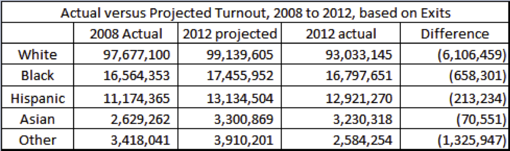

In this handout, you'll learn the essential first steps of data analysis with the tidyverse—a collection of R packages designed for clear, consistent, and reproducible data science. We'll practice importing data, exploring and summarizing it, and using intuitive "tidy" tools to work with subsets of real social science data sets. Throughout the semester, these tidyverse skills will help you efficiently wrangle, analyze, and visualize data for a wide range of research questions.

## How to use this handout

-   Work **top to bottom**. Run each code chunk with the green ▶ button (or **Cmd/Ctrl + Shift + Enter**) and read the output before moving on.
-   Some chunks are blank on purpose. The text above each one tells you what to write.
-   Click **Render** to turn this file into a PDF. Quarto does this with Typst, which comes with Quarto, so there is nothing extra to install.

## Topics and Concepts Covered

-   Installing and loading packages
-   Basic operations on vectors
-   Loading in data
-   The structure and format of R

## R Commands Covered

-   Installing packages using `install.packages()` and loading them using `library()`
-   Creating a vector using `c` and accessing its elements using `[` and `]`
-   Basic operations on vectors: `length`, `mean`, `median`, `min`, `max`, `range`, `sum`, `prod`, `log`, `unique`
-   Reading data using `read_csv()` and `read_tsv()`
-   Summarizing the data using base R `summary()`, `names()`, and dplyr `glimpse()`, `slice()`
-   Selecting, creating, and ordering columns with `pull()`, `mutate()`, `summarize()`, and `arrange()`
-   Counting and exploring categorical values with `count()` and `distinct()`
-   Accessing help files using `?` and `??`
-   Using `$` to extract columns from a data frame

## Note

In this handout, base R syntax is shown for a few simple vector and indexing operations. For nearly everything related to working with data frames or "tibbles", we'll use the tidyverse approach (`%>%`, `mutate()`, `summarize()`, etc.), which is more readable, powerful, and preferred for modern data analysis workflows. Most data analysis uses a mix of base R and tidyverse syntax. It’s 100% okay to write code that uses a mix of approaches, and don’t let anyone tell you otherwise!

# Packages

R is a free and open-source programming language designed for data analysis, statistics, and visualization. One of R’s greatest strengths is its package system: packages are add-ons developed by the R user community that offer new functions, data tools, or visualizations. Anyone—whether you’re a professional statistician or an enthusiastic beginner—can write and share their own R package, which helps the language grow and keeps R on the cutting edge of data science. All downloads of R contain 29 "built-in" packages. You can find these built-in packages: [here](https://cran.r-project.org/doc/FAQ/R-FAQ.html#R-Add_002dOn-Packages). As of January 2026 there are over 23,000 packages available for download by users. You can find a table of these contributed packages: [here](https://cran.r-project.org/web/packages/).

The [**tidyverse**](https://tidyverse.org) is a collection of popular R packages that are designed to make data analysis easier, more consistent, and more readable. The tidyverse and its component packages are among the **most downloaded libraries on CRAN** (the Comprehensive R Archive Network), reflecting their importance and popularity across the global R community.

As you progress in R, you’ll find yourself installing and using a wide variety of packages tailored to different types of analysis or projects. This means you’ll learn to combine the unique functions, syntax, and tools from different packages—mixing and matching what works best for your data and your research questions.

**CRAN** (the Comprehensive R Archive Network) is a worldwide network of servers (“mirrors”) that store and share R and its packages. When you install a package for the first time, R needs to know **which mirror (server location) to download from**. If one isn’t specified, you’ll get an error. So, before installing any packages, you must either choose a mirror when prompted, or include the **`repos = "https://cloud.r-project.org"`** argument in your **`install.packages()`** command.

```{r}
#| eval: false
install.packages("tidyverse", repos = "https://cloud.r-project.org")
```

You only need to install a package once. If you already installed the tidyverse at the start of the workshop, skip this chunk. It is set not to run when you render.

You will not be able to use the functions, objects, or help files in a package until you load it with [`library()`](https://rdrr.io/r/base/library.html). Once you have installed a package, you can load it using the [`library()`](https://rdrr.io/r/base/library.html) function:

```{r}
library(tidyverse)
```

# Working with Vectors

Before beginning an example from an influential paper in political science, we are going to work with some data on turnout from the 2008 and 2012 United States Elections. The data are reprinted below.



## Creating Vectors

A vector is simply a collection of numbers or strings. Vectors are constructed in R from using the `c` function, which is used to *concatenate* objects into a single vector. We are going to create a set of vectors, one for each column in Trende's figure.

```{r }
actual_2008 <- c(97677100, 16564353, 11174365, 2629262, 3418041)
projected_2012 <- c(99139605, 17455952, 13134504, 3300869, 3910201)
actual_2012 <- c(93033145, 16797651, 12921270, 3230318, 2584254)

difference <- actual_2012 - projected_2012
difference
```

We can recall any element of a vector by using brackets.

```{r }
actual_2008[2]

actual_2012[1] - projected_2012[1]
```

R allows us to perform any number of operations on a vector:

```{r }
length(actual_2008) # Number of elements in a vector

mean(actual_2008) # Average of the elements

median(actual_2008) # Middle element, when sorted

min(actual_2008) # Smallest element

max(actual_2008) # Largest element

range(actual_2008) # Range of a vector

sum(actual_2008) # Adds all of the numbers in a vector

prod(actual_2008) # Multiplies all of the numbers in a vector

log(actual_2008) # Logarithm (natural) of all elements in a vector

unique(actual_2008) # Lists each distinct element in a vector
```

### Coding Tip

If you want to access RStudio's help functions, click on the 'Help' tab in the lower right hand box, and type in your question. If you want to access help files from the command line, type in `?command`, e.g. `?sum` to learn about the `sum` function. If you do not remember the exact name of a command, type `??summar` and R will use 'fuzzy matching' to suggest some commands you might be looking for.

## Giving Names to a Vector

Next, we give names to a vector:

```{r }
names(actual_2008) # No names yet

names(actual_2008) <- c("White", "Black", "Hispanic", "Asian", "Other")

actual_2008

actual_2008["White"]
```

## From Vectors to Tibbles (and the Power of "tidy" Data)

While vectors are the basic building blocks in R, most real-world datasets—especially in the social sciences—are made up of multiple variables measured for many units (like people, counties, or years). In R, we organize this kind of data in data frames, which are tables where each column is a vector (like the ones we just created), and each row is an observation.

The tidyverse introduces a modern version of the data frame called a "tibble." Tibbles are still tables of data, but they're designed to be easier to use and to work smoothly with the rest of the tidyverse tools. For example, tibbles give clearer printing, prevent accidentally turning strings into factors, and play nicely with data wrangling and visualization functions.

Let’s see how to take our three vectors (one for each election year) and combine them into a single tibble, where each row represents one group (White, Black, Hispanic, Asian, Other):

```{r}
turnout <- tibble(
  group = c("White", "Black", "Hispanic", "Asian", "Other"),
  actual_2008 = actual_2008,
  projected_2012 = projected_2012,
  actual_2012 = actual_2012
)
turnout
```

## The Pipe Operators: %\>% and \|\>

The pipe operator is a special tool that helps you write R code in a clear, readable, step-by-step way. Introduced to R through the magrittr package (and made central to the tidyverse), the pipe is written as %\>% and lets you "pipe" the result of one function into the next—making data analysis more like reading a sentence from left to right. For example, instead of nesting functions like mean(log(x)), you can write x %\>% log() %\>% mean(), which is much easier to follow.

Because the tidyverse (especially dplyr and ggplot2) became so popular, this piping style became very common in R. In recognition of this, base R now contains its own pipe operator, written as \|\>. You can use either %\>% (from the tidyverse/magrittr) or \|\> (from base R); both help you chain together multiple data transformation steps for clear and reproducible analysis.

Let's calculate the difference in projected vs. realized turnout again, but this time as two variables in the data frame `turnout`.

```{r}
difference <- turnout$actual_2012 - turnout$projected_2012
```

But what if we wanted to add our difference vector as a variable to our tibble (data frame)? We can do this easily by using the `mutate()` function in the tidyverse package dplyr.

```{r}
turnout <- turnout %>%
  mutate(diff_2012 = actual_2012 - projected_2012)
turnout
```

If we want just want the vector of differences but still wish to use tidyverse syntax, we can use `mutate()` and `pull()`:

```{r}
difference <- turnout %>%
  mutate(difference = actual_2012 - projected_2012) %>%
  pull(difference)
```

Now, let's say that we want to know which group had the largest projected vs. realized turnout change in 2012. We can figure this out using the dplyr functions `arrange()`, which orders the rows of a data frame by the values of selected columns, and `slice()` which lets us index rows by location. Since we are just interested in which group had the largest turnout drop, we don't need to assign the output back to our tibble.

```{r}
turnout %>% arrange(diff_2012) %>% slice(1)
```

Does the answer surprise you? Why or why not? What other variable "mutations" would be helpful here?

# Example: Disaster Relief Aid and Support for the Incumbent President.

In this section, we analyze the relationship between disaster relief aid and support for the incumbent President's party, from 1988-2004. Political economists have long theorized that incumbent political leaders may 'buy' votes, through dispensing aid to sub-national political units in order to shore up electoral support.

@Healy.Malhotra2009 examined whether this effect is present in the contemporary United States. We are going to conduct an abridged version of their study, though the basic findings will be similar.

The authors explored the relationship between county-level support for the incumbent President's party and disaster aid disbursed to the county. Each observation is a county in the United States, observed in the four years before five consecutive elections (1988, 1992, 1996, 2000, and 2004). Like the authors, we are interested in characterizing a causal relationship between disaster aid disbursement and support for the incumbent party's candidate in the election.

The dataset `disasteraid.csv` is available as a comma-separated and tab-delimited file in the `data` folder. Comma separated files have the suffix `.csv`, while tab-delimited files often have the suffix `.tsv` or `.txt`.

The data contains the following variables:

| Name | Description |
|:---|:---|
| `fips` | An identifier for each county. This is the level of government that received aid. |
| `year` | The year for which the variables are observed. |
| `incum_vote` | The percent of the vote received by the incumbent's party for that county in that election. |
| `prev_incum` | The percent of the vote received by the incumbent's party in the previous election. |
| `all_current_irelief` | A measure of disaster aid relief received, per capita, in the county. |

## Reading Data into R

First, we must load in the data. Here the data is in the `data` folder next to this file.

When we read in a file we will follow a *three-step procedure*:

1.  Read it in
2.  Check the first five rows
3.  Get a quick summary of the data. (Note: `summary()` is a base R command)

Name the data frame `data_disaster`. The sections below refer to it by that name.

This process will ensure that we have loaded in the data without error.\
The structure is given below.

### Reading in a tab-delimited `.tsv` or `.txt` file.

```{r }

```

### Reading in a comma-separated `.csv` file.

```{r }

```

## Notes

The package readr assumes that the first row of the file should be used to name each column. Sometimes the first row of a data file does not correspond to the name of each column, but is the first observation. If this is the case we need to either specify no header: `read_csv("file.csv", col_names = FALSE)`, or provide a header of our own choosing: `read_csv("file.csv", col_names = c("x", "y", "z"))`

When you read in a data frame, it shows up in the "Environment" pane (upper right hand box) of RStudio.

## Attributes of Data Frames

So far, we have been looking at a single data frame, `data_disaster`. A `data.frame` contains one column for each variable, and one row for each observation. Below are some basic operations on data frames.

We can get the names of the columns of the data frames:

```{r }

```

The function `glimpse()` gives you an overview of your data frame. It gives you a count of rows and columns, but also lists all variables, their type, and as many values for each variable as possible.

```{r }

```

The functions `nrow()` and `ncol()` return the number of rows and columns only.

```{r }

```

We can extract columns of a data frame several different ways. Sometimes it is simplest to use base R. We can use `$` to extract the column directly by name and work with it.

```{r }

```

The tidyverse equivalent command is `pull()`

```{r}

```

Or we can use a `summarize()` statement:

```{r}

```

If we want to know all of the possible (unique) values a variable can take on we can use `distinct()`

```{r}

```

# The Structure of R

So far, we have encountered the following elements when working with R:

-   The **file editor**. Whether using an R script, an R Markdown file, or a Quarto file this should contain all of the commands necessary to replicate your analysis, as well as comments explaining the code.

-   The **Project folder**. This is the main folder for your RStudio Project—R will look for all files here by default, and will save any new files you create in this location.

-   The **workspace**. This is the set of all objects in your current R session.

The work space will include variables, vectors, data frames, and a history of all commands you've run in this session. When you close RStudio, you will be asked if you want to save your work space. In general, you will *not* want to. We save scripts, not the work space. (You can change the Preference settings inside RStudio if you decide you never want to be asked).

# Workshop Questions

In 2013 a federal judge ruled that the New York City Police Department's stop-and-frisk program was unconstitutional. In her ruling, the judge found that the program constituted racial profiling as police officers disproportionately targeted Black and Hispanic residents [link](https://ccrjustice.org/files/Floyd-Liability-Opinion-8-12-13.pdf). The program allowed police in NYC to temporarily detain and search pedestrians. For an overview of the program, see the first few pages of @Gelman.etal2007a.

Long before the judicial ruling, concerns arose that Black and Hispanic individuals were being stopped at higher rates than whites. We are going to load in and look at some of the stop-and-frisk data. The data is large, with 532,911 observations and 101 variables. We will be looking at a subset of this data. You will find the data in the `data` folder. It is called `subset_saf.csv`, so the path from the folder where this file is to the data is `data/subset_saf.csv`.

Please answer the following questions.

### Question 1

Read the data into a data frame named `saf`.

```{r, solution = TRUE}

```

### Question 2

How many rows and how many columns are in the subset of the data?

```{r, solution = TRUE}

```

### Question 3

What year is the data from?

```{r, solution = TRUE}

```

### Question 4

What are the youngest and oldest ages?

```{r, solution = TRUE}

```

### Question 5

Assuming that NYC cops are arresting neither infants nor Yoda, what could be going on here instead?

```{asis, solution = TRUE}

```

Often, when you use data for your research, variable names and descriptions will be found in a code book. The code book for the full data set can be found [here](https://www.nyclu.org/sites/default/files/SQF_Codebook.pdf).

### Question 6

How many different categories of race are considered?

```{r, solution = TRUE}

```

### Question 7

Is the mean statistic returned from either `summary(saf$race)` or the tidyverse equivalent `saf %>% pull(race) %>% mean()` useful in characterizing the "average race" of those stopped and frisked?

```{asis, solution = TRUE}

```

### Question 8

Try the command `saf %>% count(race)`.

```{r, solution = TRUE}

```

What does command `count()` do? Use `?count()` or search in the Help window.

```{asis, solution = TRUE}

```

# References
