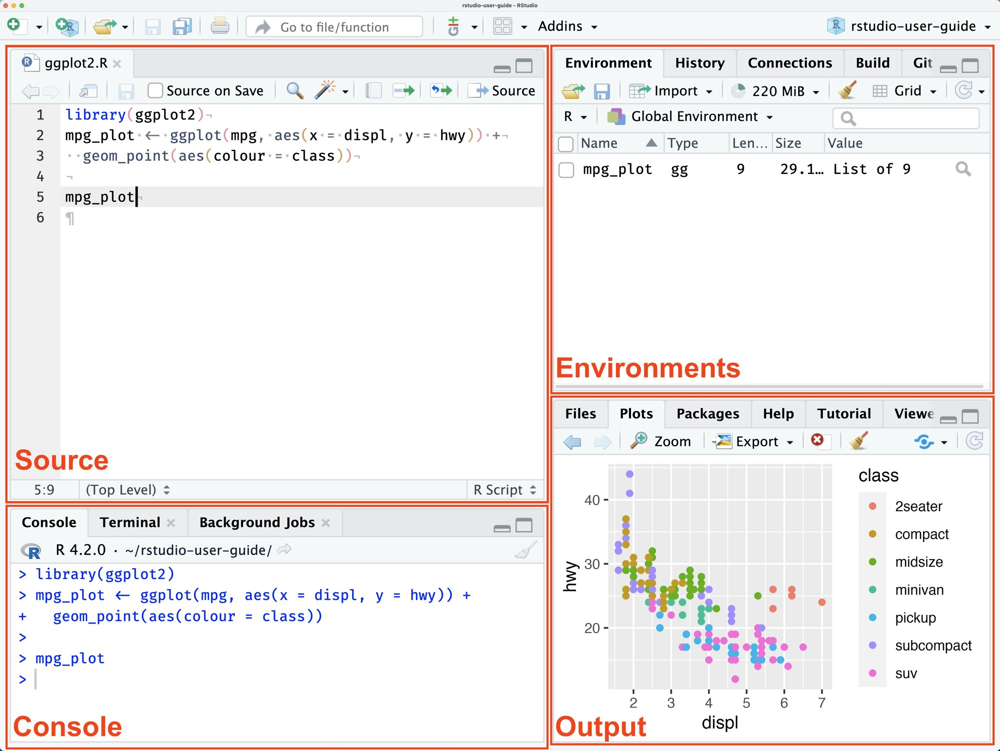
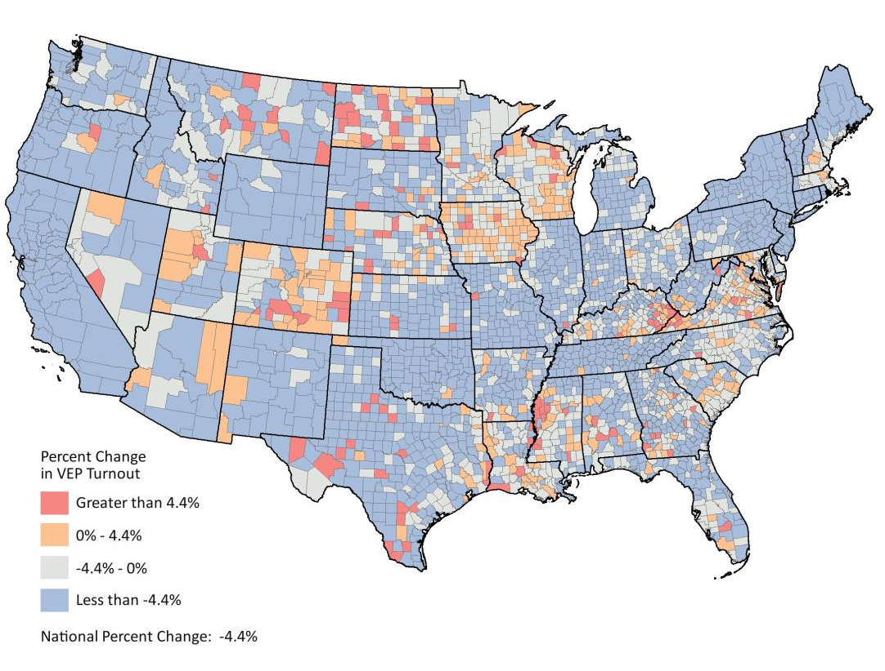

## Plan for the next two hours

| When | What |
|:------|:---------------------------------------------------|
| **0:00** | **Install together:** R, RStudio, tidyverse, and a Quarto check |
| **0:20** | A short tour of RStudio and Quarto, plus good habits |
| **0:40** | **Guided walkthrough:** vectors, tibbles, and pipes |
| **1:05** | **You work through the handout** while I circulate |
| **1:50** | Wrap-up: staying current and where to go next |

::: {.callout-note}
## Install first. Talk second.
We start with installation so anything that goes wrong has time to get fixed.
:::

::: {.notes}
Times are a guide. Install block is 20 minutes: if people are still stuck at 0:20, keep going and fix them one on one while the tour runs.
:::

# Part 1 {.part background-color="#0f6e73" transition="slide"}

Let's get set up

::: {.notes}
Goal for this block: everyone leaves it with R, RStudio, tidyverse and a working Quarto render to HTML and PDF. Walk around, look at screens.
:::

## <span class="stepno">1</span> Get the workshop files

Everything for today is in one place:

**[github.com/swat-ssql/intro-r-workshop](https://github.com/swat-ssql/intro-r-workshop)**

1. Open the link, click the green **Code** button, then **Download ZIP**
2. **Unzip** it somewhere you'll find it again (not inside Downloads)
3. Keep the page open: the **README** links to the R and RStudio downloads we need next

::: {.notes}
The repo is public, so no GitHub account is needed. If a student unzips to Downloads, ask them to move the folder first, since projects inside Downloads are easy to lose. The README's Software table has the CRAN and RStudio download links.
:::

## The two things you're installing

::: {.columns}
::: {.column width="48%"}
::: {.card}
<h3>R</h3>
The **language and engine**. It does the actual computing.

Free, open source, and maintained by a worldwide community.
:::
:::
::: {.column width="4%"}
:::
::: {.column width="48%"}
::: {.card .warm}
<h3>RStudio</h3>
The **workspace** that makes R easier to use: editor, console, plots, and help in one window.

This is the program you'll open.
:::
:::
:::

**Order matters: install R first, then RStudio.** Both download links are in the repo's README.

::: {.notes}
Analogy: R is the engine, RStudio is the dashboard. You never open R directly; you open RStudio and it drives R for you.
:::

## <span class="stepno">2</span> Install R

::: {.panel-tabset}

### Mac

1. Go to [cran.r-project.org](https://cran.r-project.org) and click **Download R for macOS**
2. Download the installer (`.pkg`) that matches your chip: **Apple silicon** (M1, M2, M3, ...) or **Intel**
   <br><span class="muted">Not sure? Apple menu  → About This Mac.</span>
3. Open the `.pkg` and click through the installer
4. Open **Terminal** (⌘ + Space, type "terminal") and run:

```bash
xcode-select --install
```

Say yes to installing the command line tools. Already have them? You're set.

### Windows

1. Go to [cran.r-project.org](https://cran.r-project.org) and click **Download R for Windows**
2. Click **base**, then download the installer and run it (the defaults are fine)
3. *Optional:* install **Rtools** from the [Rtools page](https://cran.r-project.org/bin/windows/Rtools/), choosing the version that matches your R. You only need it if a package install asks for it.

:::

::: {.notes}
Mac: the Apple silicon vs Intel choice is the most common stumble. Windows: Rtools is only needed for packages compiled from source, so skip it unless an error asks for it. If a stray R icon lands on the desktop, ignore it; we only open RStudio.
:::

## <span class="stepno">3</span> Install RStudio

1. Go to [posit.co/download/rstudio-desktop](https://posit.co/download/rstudio-desktop/)
2. Download the installer and run it (Mac: drag RStudio into Applications)
3. Double-click **`intro-r-workshop.Rproj`** to open the project
4. Type this into the **Console** (bottom left) and press Enter:

```r
R.version.string
#> [1] "R version 4.6.x (...)"
```

::: {.callout-tip}
## An R version means RStudio and R are talking. The Files pane should list `handout.qmd`.
:::

::: {.notes}
Expected output depends on when they installed; anything 4.5 or newer is fine for today. RStudio also installs a copy of Quarto, which we check in step 5. Opening the .Rproj sets RStudio's working directory to the project folder, which the handout needs for relative paths like data/subset_saf.csv.
:::

## <span class="stepno">4</span> Install the tidyverse

```r
install.packages("tidyverse", repos = "https://cloud.r-project.org")
```

- Takes a few minutes. Lots of scrolling text is normal.
- If it asks *"Do you want to install from sources...?"*, answer **No**.
- You install a package **once**. You load it with `library()` **every session**:

```r
library(tidyverse)
```

You should see **"Attaching core tidyverse packages"** and a list of packages.

::: {.notes}
The repos argument avoids the "CRAN mirror not set" error mentioned in the handout. A Conflicts message after library(tidyverse) is normal. Installing the tidyverse also installs the packages Quarto needs to run R code (knitr, rmarkdown), which is why this comes before the Quarto check.
:::

## <span class="stepno">5</span> Check that Quarto works

You'll need **Quarto** to turn a `.qmd` file into a finished document. **RStudio already includes it**, so there's nothing extra to download.

1. **File → New File → Quarto Document...**, then click **Create** (leave HTML selected). If it offers to install packages, say **yes**
2. Save the file, then click the blue **Render** arrow. An HTML preview should open
3. Now try a PDF: change `format: html` to `format: typst` in the header and **Render** again. Typst comes with Quarto, so nothing else to install

::: {.callout-warning}
## Render says Quarto isn't found, or the PDF fails?
Install Quarto from [quarto.org/docs/download](https://quarto.org/docs/download/). HTML always works, and that's fine for today.
:::

::: {.notes}
Quarto has been bundled with RStudio since version 2022.07.1 (per Posit's docs), and Quarto includes the Typst command line tool, so a current RStudio install can make PDFs with no extra software. The default new Quarto document includes a plot, which is a good test. If anyone's PDF fails, move on: the handout works fine as HTML (change format: typst to format: html in the handout header) and you can fix it later.
:::

## Checkpoint

Hand up if any of these aren't green:

- [ ] The workshop project is open (the Files pane shows `handout.qmd`)
- [ ] `R.version.string` prints a version
- [ ] `library(tidyverse)` runs without an error
- [ ] A test Quarto document renders to HTML and to PDF (`format: typst`)

::: {.notes}
The tour can start while stragglers finish.
:::

# Part 2 {.part background-color="#0f6e73" transition="slide"}

A quick tour

## A tour of RStudio

{fig-align="center" height="560px"}

::: {.notes}
Four panes: Source (top left), Console (bottom left), Environment/History (top right), Files/Plots/Packages/Help/Viewer (bottom right). Keep this to a minute; students learn it by using it.
:::

## Where does my code live?

::: {.columns}
::: {.column width="33%" .fragment}
::: {.card}
<h3>Console</h3>
Try things out. Quick answers.

**Not saved.**
:::
:::
::: {.column width="33%" .fragment}
::: {.card}
<h3>Script (<code>.R</code>)</h3>
A saved list of commands.

Run a line with **⌘/Ctrl + Enter**.
:::
:::
::: {.column width="33%" .fragment}
::: {.card .warm}
<h3>Quarto (<code>.qmd</code>)</h3>
Code + writing + results in one document.

Press **Render** to build it.
:::
:::
:::

<br>

::: {.big .fragment}
**Rule of thumb: if you want to keep it, it goes in a file.**
:::

## Can I only use R in a Quarto file in RStudio?

**No.** R is the same everywhere. Only the place you type changes.

::: {.fragment}
| Where | Good for |
|:-----------------------------|:-------------------------------------|
| **R console**: the Console pane, or type `R` in a terminal | quick experiments |
| **Script** (`.R`) | just code; run a line at a time or the whole file |
| **Quarto** (`.qmd`) | code + writing + results in one document |
| **Other editors**: Positron, VS Code | same R in a different workspace |
:::

::: {.fragment}
```bash
Rscript handout_code.R     # run a whole script from a terminal
```
:::

::: {.fragment}
::: {.callout-tip}
## See the difference
`handout_code.R` in the repo holds the same code as `handout.qmd`, as a plain script. Open them side by side.
:::
:::

::: {.notes}
The point: a Quarto file is one way to organize R work, not a requirement. Scripts hold only code (comments start with #); Quarto mixes code and prose and produces a finished document. Both can be run in RStudio, in Positron or VS Code, or from the command line (Rscript runs a script; quarto render builds a .qmd). Have students open handout_code.R and handout_guide.qmd side by side and compare.
:::

## Quarto: code, writing, and results together

````markdown
---
title: "My analysis"
format: html
---

Some **text** written in Markdown.

```{{r}}
mean(c(2, 4, 6))
```
````

::: {.incremental}
- The top block (**YAML**) sets the title and output format: PDF, HTML, or Word
- Text goes in normal paragraphs. Code goes in **chunks**
- Press **Render** and Quarto runs the code and builds the document
- `handout.qmd` is a Quarto file, and it renders to PDF with Typst
:::

::: {.notes}
Quarto is the successor to R Markdown, made by Posit. It also makes slides (this deck), websites, and more. Same idea: one file holds your code, results, and writing, so the document always matches the analysis.
:::

## Projects and the working directory

`getwd()` tells you which folder R is looking in right now.

::: {.incremental}
- Open the workshop as a **Project**: double-click `intro-r-workshop.Rproj` (or File → Open Project)
- Now file paths are relative to the project folder:
:::

```r
read_csv("data/subset_saf.csv")
```

- Avoid `setwd("/Users/you/Desktop/...")`. It breaks on every other computer.

::: {.notes}
If the working directory is wrong, read_csv() fails with "file not found". That's the most common error on the handout; getwd() is the first diagnostic.
:::

## Objects, functions, packages

```r
x <- c(2, 4, 6)       # <- stores a value in an object called x
mean(x)               # functions look like name(inputs)
#> [1] 4
library(tidyverse)    # packages add more functions
```

::: {.incremental}
- **Assign** with `<-` (shortcut: **Option/Alt + -**)
- **Call** a function with `name(inputs)`
- **Install** a package once, **load** it every session
:::

# Part 3 {.part background-color="#0f6e73" transition="slide"}

Good habits from day one

## Stay organized

::: {.incremental}
1. **One project folder** per course or analysis, with data, code, and output kept in clear places
2. Work in a **script or Quarto file**, not just the console
3. **Raw data stays raw.** Never edit the original file. Do all cleaning in code so you (or anyone else) can rerun it
4. Use clear names: `snake_case`, and `turnout` rather than `df2`. Avoid spaces in file names
5. Comment the **why**, not just the what
:::

## Know your data before you analyze it

::: {.columns}
::: {.column width="50%" .fragment}
::: {.card}
<h3>What is one row?</h3>
A county-year? A police stop? A person? This is your **unit of observation**.
:::
:::
::: {.column width="50%" .fragment}
::: {.card}
<h3>Read the codebook</h3>
What does each variable mean, in what units, and how are **missing values** coded (`NA`, `-99`, `999`)?
:::
:::
:::

::: {.columns}
::: {.column width="50%" .fragment}
::: {.card .warm}
<h3>Look before you leap</h3>
`glimpse()`, `summary()`, `count()`. Do the ranges make sense? An age of 0 or 999 should stop you.
:::
:::
::: {.column width="50%" .fragment}
::: {.card .warm}
<h3>Remember the people</h3>
Behind each row of social data is a person. Handle it with care.
:::
:::
:::

::: {.notes}
Ties directly to the handout: Questions 3-5 ask about ages in the stop-and-frisk data, and Question 6 and 8 about race categories. Mention that the codebook is linked in the handout.
:::

## Make it reproducible

::: {.incremental}
- **Restart R and run everything top to bottom** (Session → Restart R, then Render) before you submit. If it works from scratch, it works.
- **Don't save your workspace.** Tools → Global Options → General: set *Save workspace to .RData on exit* to **Never** and untick *Restore .RData into workspace at startup*
- **Know your versions:** `sessionInfo()` lists R and package versions
- Later: version control with **git and GitHub** (this workshop lives in a repo)
:::

::: {.notes}
We save scripts, not workspaces. The handout's "Structure of R" section says the same thing; this is the one setting worth changing today.
:::

# Part 4 {.part background-color="#0f6e73" transition="slide"}

Guided walkthrough: from vectors to tibbles

::: {.notes}
Code along. Students type or copy each snippet into a new script or into handout.qmd. Outputs below were generated by running this code in R. Pause for questions at each concept check.
:::

## The data you'll meet today

::: {.columns}
::: {.column width="33%" .fragment}
{.thumb}

**Voter turnout, 2008 vs. 2012.** Vectors and tibbles.
:::
::: {.column width="33%" .fragment}
{.thumb}

**Disaster aid and the incumbent vote.** Healy and Malhotra (2009).
:::
::: {.column width="33%" .fragment}
{.thumb}

**NYC stop-and-frisk.** Your questions at the end.
:::
:::

## Follow along in the handout

::: {.incremental}
1. Open **`handout.qmd`** (in the project you opened earlier) and put your name in the header
2. Work **top to bottom**: run each chunk with the green ▶ (or **⌘/Ctrl + Shift + Enter**) and read the output
3. **Run the code as I show it.** The vectors-to-pipes code is already in the handout
4. Some chunks are blank on purpose. `handout_guide.pdf` shows the finished versions
5. Do the **Workshop Questions** on your own at the end
6. **Render** to PDF when you're done
:::

::: {.notes}
Cmd/Ctrl + Enter runs the current line or selection; adding Shift runs the whole chunk. Students run the walkthrough code in the handout while you present it on the slides. Suggested pacing for the independent part (guess): reading the disaster-aid data ~15 min, Workshop Questions Q1-Q8 ~20+ min. Circulate and look for working-directory problems first.
:::

## Working with vectors

We'll take the turnout figures from Trende's chart in the handout and **combine** them into vectors, one per column.

```r
actual_2008    <- c(97677100, 16564353, 11174365, 2629262, 3418041)
projected_2012 <- c(99139605, 17455952, 13134504, 3300869, 3910201)
actual_2012    <- c(93033145, 16797651, 12921270, 3230318, 2584254)
```

. . .

Math works **element by element**:

```r
difference <- actual_2012 - projected_2012
difference
#> [1] -6106460  -658301  -213234   -70551 -1325947
```

## Picking out elements: `[ ]`

```r
actual_2008[2]
#> [1] 16564353

actual_2012[1] - projected_2012[1]
#> [1] -6106460
```

. . .

**Concept check:** what did each line do?

. . .

The first picks the **2nd** element. The second subtracts the **1st** projected value from the **1st** actual value.

## Common vector functions

```r
length(actual_2008)   # 5
mean(actual_2008)     # about 26.3 million
median(actual_2008)   # 11174365
range(actual_2008)    # 2629262 97677100
sum(actual_2008)      # 131463121
```

. . .

The handout adds `min()`, `max()`, `prod()`, `log()`, and `unique()`. Try them on your own.

## Naming vectors

```r
names(actual_2008)    # no names yet
#> NULL

names(actual_2008) <- c("White", "Black", "Hispanic", "Asian", "Other")
actual_2008
#>    White    Black Hispanic    Asian    Other
#> 97677100 16564353 11174365  2629262  3418041
```

. . .

```r
actual_2008["White"]
#>    White
#> 97677100
```

## From vectors to tibbles

A dataset is just **named vectors side by side**.

::: {.incremental}
- Vectors are single columns of numbers or labels
- Real data are **tables**: many columns, each a variable
- **Tibbles** (from the tidyverse) are tables that print more clearly and play nicely with tidyverse tools
- Let's combine our vectors into one
:::

## Building a tibble {.tight}

```r
turnout <- tibble(
  group = c("White", "Black", "Hispanic", "Asian", "Other"),
  actual_2008 = actual_2008,
  projected_2012 = projected_2012,
  actual_2012 = actual_2012
)
turnout
```

. . .

```r
#> # A tibble: 5 × 4
#>   group    actual_2008 projected_2012 actual_2012
#>   <chr>          <dbl>          <dbl>       <dbl>
#> 1 White       97677100       99139605    93033145
#> 2 Black       16564353       17455952    16797651
#> 3 Hispanic    11174365       13134504    12921270
#> 4 Asian        2629262        3300869     3230318
#> 5 Other        3418041        3910201     2584254
```

## Try breaking it

What happens if you delete `, "Other"` so that

```r
group = c("White", "Black", "Hispanic", "Asian")
```

. . .

R refuses, and tells you why:

```r
#> Error in `tibble()`:
#> ! Tibble columns must have compatible sizes.
#> • Size 4: Existing data.
#> • Size 5: Column `actual_2008`.
```

. . .

Columns in a table must all be the **same length**. Reading error messages is a skill.

::: {.notes}
Let students predict first. The exact wording of the error can vary slightly by package version.
:::

## Pipes: `%>%` and `|>`

::: {.incremental}
- A pipe passes the result of one step into the next, so code reads **left to right**
- `%>%` (tidyverse) and `|>` (base R) do the same job here
- You can **chain** steps instead of nesting them
:::

. . .

```r
mean(log(x))                # nested: read from the inside out

x %>% log() %>% mean()      # piped: read left to right
x |> log() |> mean()        # same thing, base R pipe
```

## Pulling out and adding columns {.tight}

`$` pulls out one column **by name**: `object$column`

```r
turnout$actual_2012 - turnout$projected_2012
#> [1] -6106460  -658301  -213234   -70551 -1325947
```

. . .

`mutate()` **adds** a column to the tibble:

```r
turnout <- turnout %>%
  mutate(diff_2012 = actual_2012 - projected_2012)
```

. . .

Just want the vector back? Add `%>% pull(diff_2012)`. The handout shows how.

## Adding a column: the result {.tight}

```r
turnout
#> # A tibble: 5 × 5
#>   group    actual_2008 projected_2012 actual_2012 diff_2012
#>   <chr>          <dbl>          <dbl>       <dbl>     <dbl>
#> 1 White       97677100       99139605    93033145  -6106460
#> 2 Black       16564353       17455952    16797651   -658301
#> 3 Hispanic    11174365       13134504    12921270   -213234
#> 4 Asian        2629262        3300869     3230318    -70551
#> 5 Other        3418041        3910201     2584254   -1325947
```

The new `diff_2012` column sits at the end.

## Which group had the biggest drop? {.tight}

`arrange()` sorts the rows. `slice(1)` keeps the first one.

```r
turnout %>% arrange(diff_2012) %>% slice(1)
```

. . .

```r
#> # A tibble: 1 × 5
#>   group actual_2008 projected_2012 actual_2012 diff_2012
#>   <chr>       <dbl>          <dbl>       <dbl>     <dbl>
#> 1 White    97677100       99139605    93033145  -6106460
```

. . .

**Does the answer surprise you? Why or why not?** What other new columns would help here?

::: {.notes}
A good discussion point: the largest drop in raw counts is White voters, but White voters are also by far the largest group. A percentage change column would tell a different story (Other has the biggest proportional drop). This leads naturally into "what other mutations would be helpful?" from the handout.
:::

# Part 5 {.part background-color="#0f6e73" transition="slide"}

Your turn

## Getting unstuck

1. **Built-in help:** `?mean` or `??regression`. The examples at the bottom are the best part.
2. **Read the error message.** Common causes: a typo, a missing `)` or quote, forgetting `library()`, a wrong file path.
3. **Search the exact message** along with "R" or "tidyverse".
4. **Good references:** [R for Data Science](https://r4ds.hadley.nz) and [tidyverse.org](https://www.tidyverse.org)
5. **Ask.** Me, a neighbor, or your instructor.

::: {.callout-note}
## AI chat tools
They can explain error messages, but always run what they give you and check it does what you think. Follow your course's policy.
:::

::: {.notes}
Remove or adapt the AI callout if it conflicts with how you want to frame it for this audience.
:::

## Your turn!

**Open `handout.qmd` and begin.**

When you're stuck:

- Check the **Console** for an error message and read it
- Check `getwd()`: is R in the right folder?
- Ask a neighbor, then ask me

<br>

::: {.muted}
Workshop files: [github.com/swat-ssql/intro-r-workshop](https://github.com/swat-ssql/intro-r-workshop)
:::

# Part 6 {.part background-color="#0f6e73" transition="slide"}

Wrap-up

## Keeping R, RStudio, and Quarto up to date

| | How often | How to update |
|:-----|:-----------------------|:-------------------------------------|
| **R** | A new version each spring (4.6.0 came out April 2026), plus small fixes | Download and install the new version from CRAN, then **reinstall your packages** |
| **RStudio** | Roughly monthly. Numbered by year.month (e.g., 2026.10) | Help → Check for Updates |
| **Quarto** | Comes **bundled with RStudio**, so it updates when RStudio does | Update RStudio, or download from [quarto.org](https://quarto.org/docs/download/) |
| **Packages** | Whenever their authors update them | Tools → Check for Package Updates |

::: {.callout-tip}
## Don't update in the middle of an assignment.
Update at the start of a term or a break. If everything works, you can leave it alone.
:::

::: {.notes}
Packages are stored per R version (e.g. 4.5 vs 4.6), which is why a new R version means reinstalling packages. Mention that the version in use is worth recording in any research output.
:::

## RStudio isn't the only option: meet Positron

::: {.incremental}
- A newer editor from **Posit**, the makers of RStudio, built on the same open-source base as **VS Code**
- Works with **R and Python** side by side
- Same R, same packages, same Quarto, so what you learn today carries over
- Posit says **RStudio is not going away** and will keep being maintained
- For this course we'll stick with **RStudio**, so screenshots and instructions match
:::

Curious? [positron.posit.co](https://positron.posit.co)

::: {.notes}
Sources: Posit's Positron announcement (Aug 2025) and positron.posit.co. Keep it to 30-60 seconds. The point is awareness: if you later use Python or like VS Code, Positron is worth a look.
:::

## Where to go next

::: {.incremental}
- Keep your project folder. You'll reuse these skills all semester
- Read: [R for Data Science (2e)](https://r4ds.hadley.nz), the first few chapters
- Try: **Positron**, if you're curious about Python or VS Code
- Keep asking questions: nobody learns R without getting stuck first
:::

## Keep learning with the SSQL

**Upcoming R workshops.** Register on the SSQL website.

| Date | Workshop |
|:------------|:-------------------------------------|
| **Oct. 28** | U.S. Midterm Election Modeling |
| **Nov. 5, 6** | Exploring Data in R |
| **Nov. 9, 13** | Data Visualization in R |

::: {.callout-note}
## Need help with a course or project?
Schedule an **office hours appointment** at the SSQL for course or project support.
:::

. . .

**Thank you!**

::: {.notes}
Workshop dates as provided: Oct. 28 (Midterm Election Modeling), Nov. 5 and 6 (Exploring Data in R), Nov. 9 and 13 (Data Visualization in R). Registration is on the SSQL website. If you want a link or QR code on this slide, add it to the table or callout.
:::
